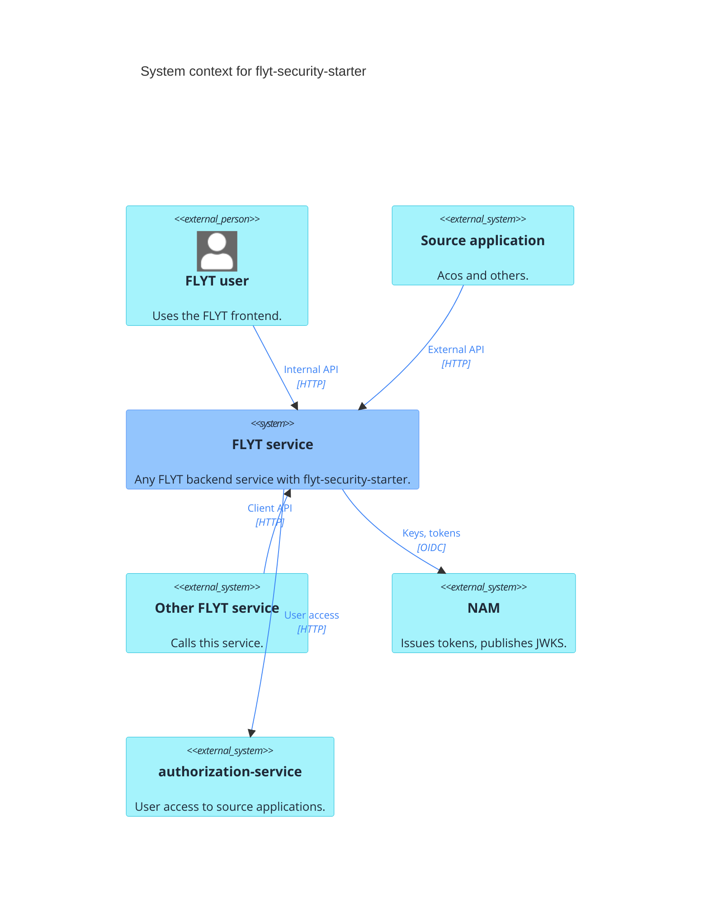
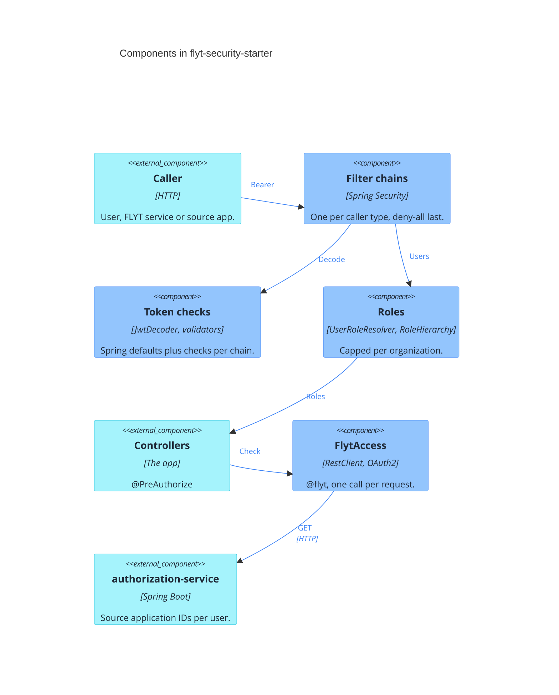

# Architecture

C4 level 1 and 3 for flyt-security-starter. Blue is this library or the services that embed it, turquoise is
external.

flyt-security-starter is a Spring Boot library, not a deployed service. Every FLYT backend service embeds it to decide
who may call which route:

| Order | Chain              | Routes                                                        | Caller                   | Rule                                                                      |
| ----- | ------------------ | ------------------------------------------------------------- | ------------------------ | ------------------------------------------------------------------------- |
| 1     | Public             | `/actuator/health/**`, `/actuator/prometheus`, `public-paths` | Anyone                   | permitAll                                                                 |
| 2     | Internal client    | `/api/intern-klient/**`                                       | Other FLYT services      | Client token, `sub` in `authorized-client-ids`                            |
| 3     | User               | `/api/intern/**`                                              | FLYT users               | Access token for the FLYT login from an allowed organization, role `USER` |
| 4     | Source application | `external.paths`, e.g. `/api/acos/**`                         | The gateway's source app | Client token, `sub` is `expected-client-id`                               |
| 5     | Deny all           | Everything else, including other Actuator endpoints           | –                        | 401                                                                       |

## C4 level 1: System context

The service validates every token with the keys NAM publishes. Only `FlytAccess` calls authorization-service, with a
`client_credentials` token from NAM. Source applications are checked locally against the gateway's own client ID.

## C4 level 3: Components

- **Token checks:** each chain wraps the app's `JwtDecoder` (signature, time and issuer, from Spring Boot) with its own
  `DelegatingOAuth2TokenValidator`. `exp` is required in every chain. A failed check gives 401.
- **User chain:** access token only (`scope` present, no `nonce` or `at_hash`), `aud` is the FLYT login client,
  `organizationid` is a tenant or operator organization, and `objectidentifier` is a UUID.
- **Client chains:** NAM sets `aud` to the client that asked for the token, so a client token has `aud` equal to
  `sub` and no `objectidentifier`.
- **Roles:** `roles` from the Vigo role catalog, capped at `tenant-max-role` (USER) for the tenant and
  `operator-max-role` (DEVELOPER) for operators. `RoleHierarchy`: DEVELOPER > ADMIN > USER.
- **FlytAccess:** `GET /api/intern-klient/authorization/users/{objectIdentifier}/source-application-ids`, once per
  request. `[]` for an unknown user. Errors and 404 give 503.
